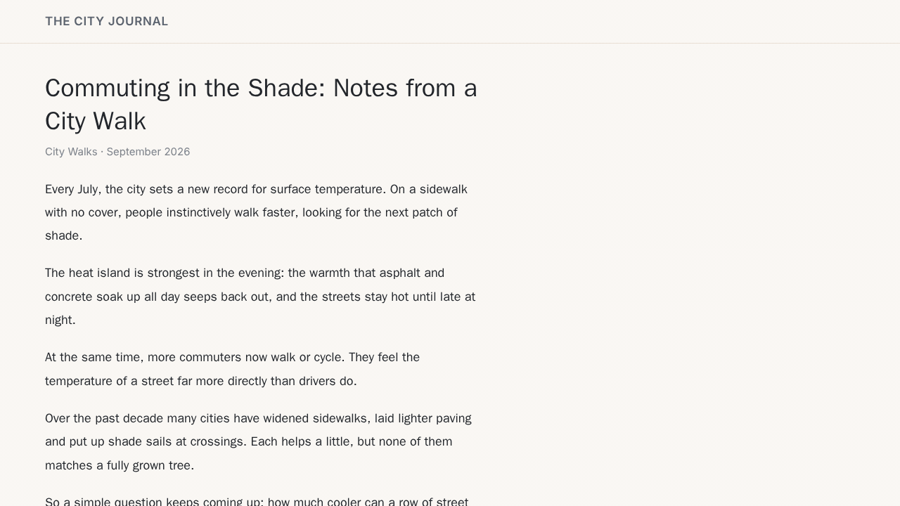
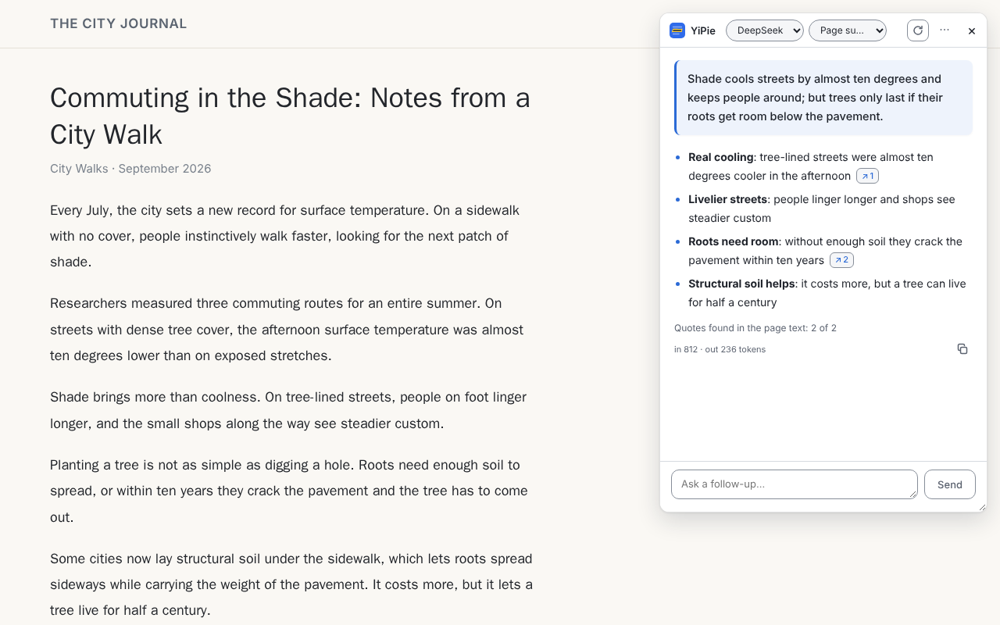
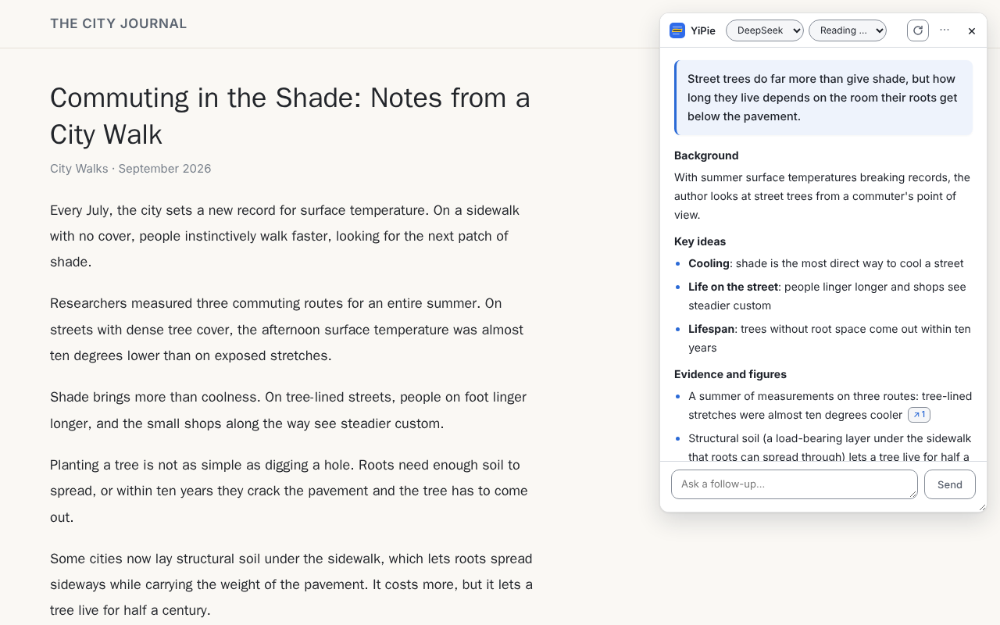
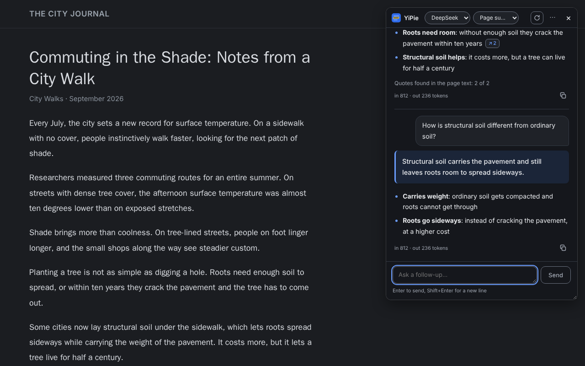
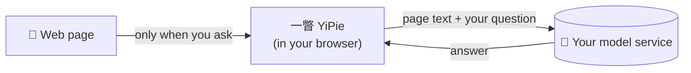

<div align="center">


# 一瞥 YiPie

**Page summaries you can check.**<br>
Every claim links back to the sentence it came from. Your own model, no server.

[](https://chromewebstore.google.com/detail/ikkkfhlajolneibfafbjfnmlnhonkmao)
[](https://microsoftedge.microsoft.com/addons/detail/eepponankaandlnacajlpdcpplclphmg)
[](https://github.com/lonemoonspace/YiPie/releases/latest)
[](https://github.com/lonemoonspace/YiPie/actions/workflows/quality.yml)
[](LICENSE)

[](https://chromewebstore.google.com/detail/ikkkfhlajolneibfafbjfnmlnhonkmao)
&nbsp;
[](https://microsoftedge.microsoft.com/addons/detail/eepponankaandlnacajlpdcpplclphmg)

**English** · [简体中文](README.zh-CN.md)

<br>



<sub>Click a citation and the page jumps to the sentence it came from. A quote that isn't in the page gets a "?" instead of passing silently.</sub>

</div>

<br>

Most AI assistants tell you *"the article says X"*, and you have no way to know whether that's really in the page. YiPie tells you *"the article says X ①"*. Click ① and the page scrolls to that sentence and highlights it. When the answer is done, YiPie checks every quote against the page text and **flags the ones it can't find**, so a made-up quote doesn't slip past you.

YiPie is a free, open source extension for Chrome and Edge. It talks directly to the model service **you** choose, in the cloud or on your own machine.

## How YiPie is different

| | Typical AI assistant | 一瞥 YiPie |
| --- | :---: | :---: |
| Every claim links back to the sentence in the page | Rarely | ✓ |
| Quotes not found in the page are flagged | Rarely | ✓ |
| Pick any model, including one on your own machine | Limited | ✓ |
| Page content passes through the extension maker's servers | Usually | **Never** |
| Account or subscription | Usually | **None** |
| Active on every page you visit | Often | **Only when you ask** |
| Open source | Rarely | **MIT** |

## Highlights

<table>
<tr>
<td width="50%" valign="top">

### 📌 Citations you can check

Click a numbered citation to scroll to the quoted text and highlight it. Once the answer is written, every quote is checked against the page, and the answer shows how many were found.

</td>
<td width="50%" valign="top">

### 🔑 Bring your own model

Works with any OpenAI-compatible Chat Completions API, in the cloud or on your own machine. Set up several models and switch between them from the panel.

</td>
</tr>
<tr>
<td valign="top">

### 🔒 Nothing in between

Page content goes only from your browser to your model service. No middleman server, no analytics, no sign-up. See the [privacy policy](PRIVACY.md).

</td>
<td valign="top">

### 💬 Keep the conversation going

Ask follow-up questions about the page. Close the panel or reload, and the conversation comes back until you close the tab.

</td>
</tr>
<tr>
<td valign="top">

### 🧩 Your prompts, your way

Three built-in presets (page summary, quick read, reading notes), plus your own prompts with a live preview of what gets sent.

</td>
<td valign="top">

### 🌗 Made to fit in

English and Chinese interface, light and dark themes, full keyboard operation, and settings import and export. Chrome and Edge 110 or later.

</td>
</tr>
</table>

## What YiPie won't do

YiPie is deliberately small: one panel that appears when you ask for it and goes away when you close it.

- **No floating button** on every page, and no sidebar that stays open.
- **No site-wide permissions** at install time. It reads a page only after you click the icon, use the context menu or press the shortcut.
- **No account**, no subscription, no server of ours.
- **No telemetry**, no ads, no remote code.

## Screenshots

<table>
<tr>
<td width="50%"></td>
<td width="50%"></td>
</tr>
<tr>
<td align="center"><sub><b>Page summary</b>: a conclusion first, then cited key points</sub></td>
<td align="center"><sub><b>Reading notes</b>: background, key ideas, evidence and open questions</sub></td>
</tr>
<tr>
<td colspan="2"></td>
</tr>
<tr>
<td colspan="2" align="center"><sub><b>Dark theme</b>, with a follow-up question</sub></td>
</tr>
</table>

## Install

| Browser | Where |
| --- | --- |
| **Chrome** | [Chrome Web Store](https://chromewebstore.google.com/detail/ikkkfhlajolneibfafbjfnmlnhonkmao) |
| **Edge** | [Microsoft Edge Add-ons](https://microsoftedge.microsoft.com/addons/detail/eepponankaandlnacajlpdcpplclphmg) |
| **Manual** | Download `yipie-<version>-chrome.zip` from [Releases](https://github.com/lonemoonspace/YiPie/releases/latest), unzip it, open `chrome://extensions` (`edge://extensions` in Edge), turn on Developer mode and click "Load unpacked" |

The stores and GitHub Releases ship the same package. What changed in each version is in [CHANGELOG.md](CHANGELOG.md).

## Quick start

1. **Connect a model.** A welcome page opens after install. Pick "I have an API key", "Try it for free" or "Use a local model", and you are set up in about a minute.
2. **Summarize.** On any page, click the YiPie icon, press `Alt+Shift+Y`, or right-click and choose "Summarize this page with YiPie".
3. **Dig in.** Click a citation to see the source, or ask a follow-up in the box at the bottom of the panel.

### Keyboard shortcuts

| Keys | Action |
| --- | --- |
| `Alt+Shift+Y` | Open the panel and summarize the page (change it at `chrome://extensions/shortcuts`) |
| `Enter` | Send a follow-up question |
| `Shift+Enter` | New line in the question box |

<details>
<summary><b>Full usage guide</b></summary>

<br>

1. **Set up a model**: besides the welcome page, you can open the extension's options page (in `chrome://extensions`, Details → Extension options). Under Models, enter a base URL (for example `https://api.openai.com/v1`), an API key and a model name, then save. Allow access when the browser asks about the service. "Common services" fills in a base URL for you, "Fetch models" picks a model name from the service's model list, and "Test connection" checks the address and key first. You can add several models and pick one with "Make default".
2. **Summarize**: the panel opens at the top right of the page and summarizes with the default model and prompt. Drag the icon at its top left to move it, and click × to close it; the ⋯ menu has "Copy text" and "Open settings". To start summaries yourself, turn off "Summarize when the panel opens" under General in the settings.
3. **Switch the model or prompt**: the two menus in the panel toolbar change the model and the prompt, and the choice becomes the new default. A new model redoes the latest answer; a new prompt clears the page's conversation and summarizes again. To switch between several models of one service, fill in "Models to switch between in the panel" for that model configuration, and the panel's model menu lists them grouped by service.
4. **Ask follow-ups**: after the summary, keep asking in the box at the bottom of the panel. If you reload the page or close the panel, open it again and the conversation comes back; it is dropped when the tab closes.
5. **Summarize a selection**: select some text, right-click and choose "Summarize the selection with YiPie".
6. **Check the source**: the small numbered markers in an answer are citations. Click one and the page scrolls to the quoted text and highlights it. Once the answer is written, YiPie checks each quote against the page text it read: a quote it could not find has a dashed marker with "?", and a line under the answer says how many of the quotes were found.
7. **Tune the summaries**: three prompt presets are built in (Page summary, Quick read and Reading notes). Edit them or add your own under Prompts in the settings; expand "Preview" while editing to see what is sent to the model. Under General you choose how to cut text that is too long, the answer language, the panel text size and the interface language. Enter each model's real context window under Models so text is cut at the right length.
8. **Back up and move**: "Import and export" in the settings saves models and prompts to a JSON file you can load in another browser. API keys are left out unless you tick the option to include them.

**Tips**

- The panel cannot open on built-in browser pages (`chrome://`, the new tab page) or extension stores; the icon shows "!" there.
- In single-page apps the panel closes when you navigate within the site. Open it again on the new page; going back to the earlier page and opening it there restores that page's conversation.
- For a local Ollama, use the base URL `http://localhost:11434/v1`. If Ollama rejects the extension's requests, set the environment variable `OLLAMA_ORIGINS=chrome-extension://*` before starting it.

</details>

## Privacy by design



- **No YiPie server.** The developer runs no backend and never receives your data.
- **Keys stay local.** API keys live in the extension's local storage, readable only by the extension's own pages.
- **Conversations are temporary.** They are kept in session storage and deleted when the tab or browser closes. Page text is never saved.

Full details are in the [privacy policy](PRIVACY.md).

## Development

Requires Node 22.18 or later.

```sh
npm ci
npm run gate    # type check, unit tests, lint, format check
npm run build   # output in .output/chrome-mv3
```

Open `chrome://extensions`, turn on Developer mode, click "Load unpacked" and choose `.output/chrome-mv3`.

Every push runs the full [quality workflow](.github/workflows/quality.yml): the gate, a production build, manifest and bundle-size checks, release package verification and end-to-end tests in a real Chromium. When it passes, the production build is uploaded as an artifact (`yipie-chrome-<commit>`, kept for 14 days), so you can try any commit without building it.

Built with [WXT](https://wxt.dev), React and TypeScript. Architecture and conventions are in [AGENTS.md](AGENTS.md), and the roadmap and technical decisions in [docs/development-plan.md](docs/development-plan.md) (both in Chinese).

## Contributing

Bug reports, ideas and pull requests are welcome. Please read [CONTRIBUTING.md](CONTRIBUTING.md) first, and report security issues privately as described in [SECURITY.md](SECURITY.md).

## License

[MIT](LICENSE) © lonemoonspace
