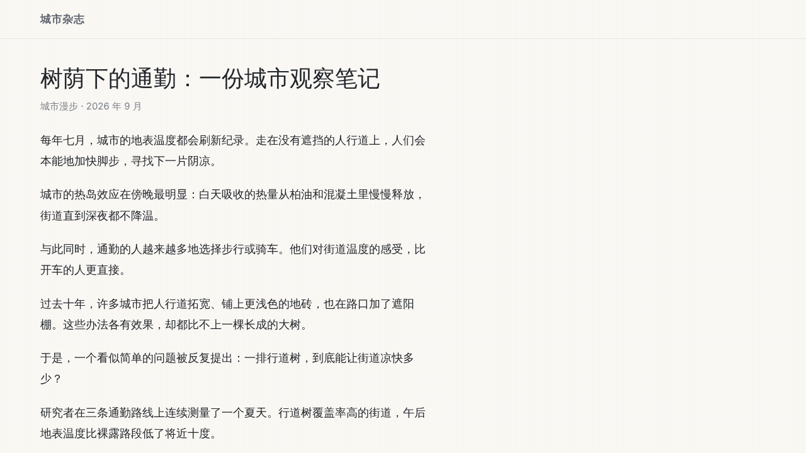
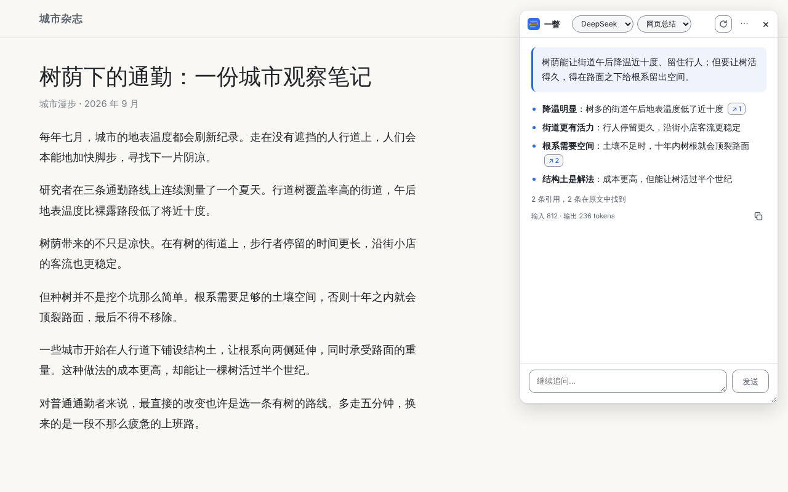
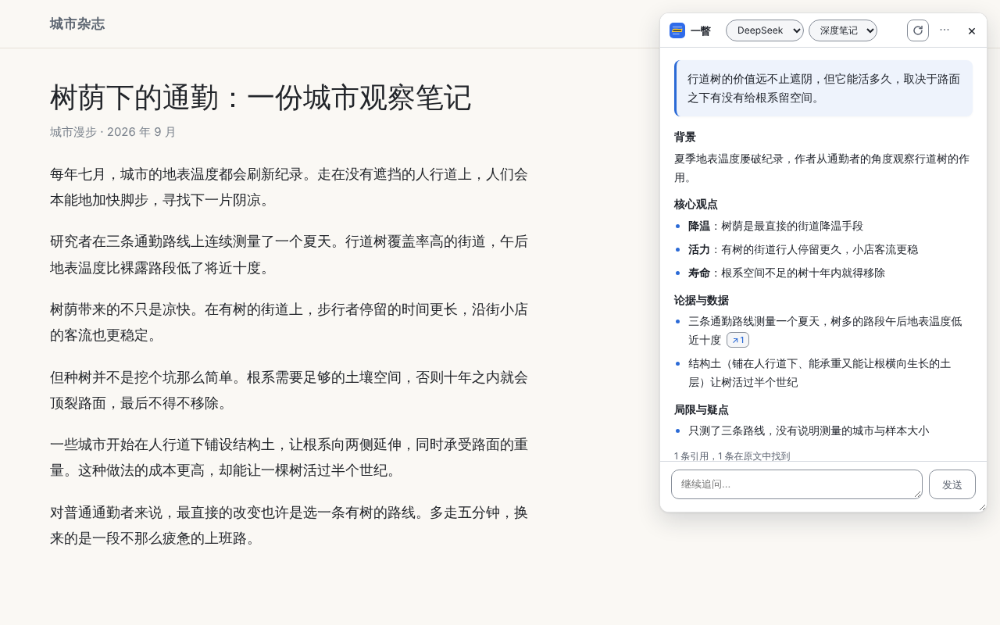
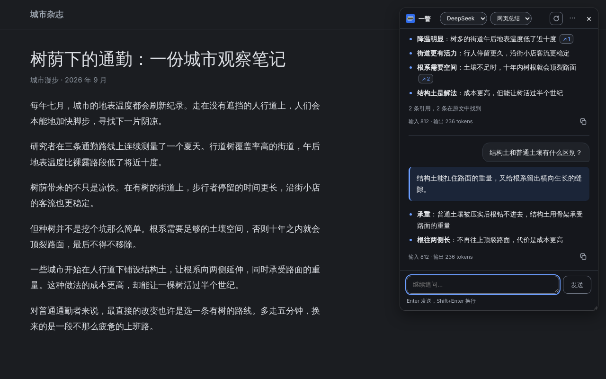
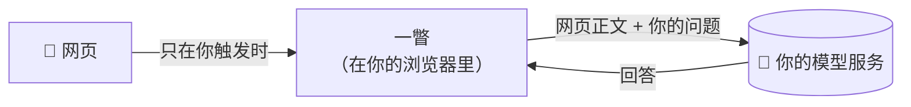

<div align="center">


# 一瞥 YiPie

**会给出处的网页总结。**<br>
每一句结论都能一键跳回原文核对。用你自己的模型，零服务器。

[](https://chromewebstore.google.com/detail/ikkkfhlajolneibfafbjfnmlnhonkmao)
[](https://microsoftedge.microsoft.com/addons/detail/eepponankaandlnacajlpdcpplclphmg)
[](https://github.com/lonemoonspace/YiPie/releases/latest)
[](https://github.com/lonemoonspace/YiPie/actions/workflows/quality.yml)
[](LICENSE)

[](https://chromewebstore.google.com/detail/ikkkfhlajolneibfafbjfnmlnhonkmao)
&nbsp;
[](https://microsoftedge.microsoft.com/addons/detail/eepponankaandlnacajlpdcpplclphmg)

[English](README.md) · **简体中文**

<br>



<sub>点一下引用，网页就跳到那句原文。原文里找不到的引用会标上「?」，不会悄悄混过去。</sub>

</div>

<br>

多数 AI 助手告诉你「文章认为 X」，你没法知道这是不是它编的。一瞥告诉你「文章认为 X ①」，点 ①，网页就滚动到那句话并高亮。回答写完后，一瞥还会用正文核对每一条引用，**把原文里找不到的标出来**，编造的引用混不过去。

一瞥是一个免费、开源的 Chrome / Edge 扩展，直接连接**你自己选的**模型服务，云端或本机都可以。

## 一瞥有什么不同

| | 多数 AI 助手 | 一瞥 |
| --- | :---: | :---: |
| 每条结论都能跳回原文那句话 | 很少 | ✓ |
| 原文里找不到的引用会被标出 | 很少 | ✓ |
| 随意选模型，包括本机模型 | 有限 | ✓ |
| 网页内容经过插件厂商的服务器 | 通常会 | **从不** |
| 需要账号或订阅 | 通常要 | **不需要** |
| 在你打开的每个网页上运行 | 常常 | **只在你触发时** |
| 开源 | 很少 | **MIT** |

## 亮点

<table>
<tr>
<td width="50%" valign="top">

### 📌 引用可回溯、自动核验

点一下带编号的引用，网页就滚动到原文并高亮。回答写完后自动用正文核对每条引用，回答下方写明有几条在原文中找到。

</td>
<td width="50%" valign="top">

### 🔑 用你自己的模型

任何 OpenAI Chat Completions 兼容接口都能用，云端服务或本机模型都行。可以配置多个模型，在面板里随时切换。

</td>
</tr>
<tr>
<td valign="top">

### 🔒 数据不经过第三方

网页内容只在你的浏览器和你的模型服务之间流动。没有中间服务器，没有统计分析，不用注册。详见[隐私政策](PRIVACY.md)。

</td>
<td valign="top">

### 💬 继续追问

总结之后就这一页继续问。关掉面板或刷新页面，再打开时对话还在，关闭标签页后才清除。

</td>
</tr>
<tr>
<td valign="top">

### 🧩 Prompt 随你调

内置「网页总结」「速读」「深度笔记」三个预设，也可以写自己的 Prompt，编辑时能预览发给模型的内容。

</td>
<td valign="top">

### 🌗 用着顺手

中英文界面、浅色与深色主题、全键盘操作、配置导入导出。支持 Chrome / Edge 110 及以上。

</td>
</tr>
</table>

## 一瞥不做什么

一瞥刻意做得小：只有一个面板，你叫它才出来，关掉就走。

- **不挂悬浮按钮**，也没有常驻的侧边栏。
- **不要全站权限**：安装时不申请任何站点权限，只在你点图标、用右键菜单或按快捷键之后才读当前页。
- **不用登录**，不收订阅，也没有我们自己的服务器。
- **不收集数据**：没有遥测，没有广告，不加载远程代码。

## 截图

<table>
<tr>
<td width="50%"></td>
<td width="50%"></td>
</tr>
<tr>
<td align="center"><sub><b>网页总结</b>：先给结论，再列带出处的要点</sub></td>
<td align="center"><sub><b>深度笔记</b>：背景、核心观点、论据与疑点</sub></td>
</tr>
<tr>
<td colspan="2"></td>
</tr>
<tr>
<td colspan="2" align="center"><sub><b>深色主题</b>，带一次追问</sub></td>
</tr>
</table>

## 安装

| 浏览器 | 安装方式 |
| --- | --- |
| **Chrome** | [Chrome 应用商店](https://chromewebstore.google.com/detail/ikkkfhlajolneibfafbjfnmlnhonkmao) |
| **Edge** | [Edge 加载项商店](https://microsoftedge.microsoft.com/addons/detail/eepponankaandlnacajlpdcpplclphmg) |
| **手动安装** | 从 [Releases](https://github.com/lonemoonspace/YiPie/releases/latest) 下载 `yipie-<版本>-chrome.zip` 并解压，打开 `chrome://extensions`（Edge 是 `edge://extensions`），开启「开发者模式」，点「加载已解压的扩展程序」。打不开 Chrome 应用商店时可以用这个办法 |

两个商店与 GitHub Releases 是同一个安装包。各版本改了什么见 [CHANGELOG.md](CHANGELOG.md)。

## 快速上手

1. **接上模型**：安装后会自动打开欢迎页，选「我有 API Key」「先免费试用」或「用本机模型」，一分钟左右就能用。
2. **总结**：在任意网页上点「一瞥」图标、按 `Alt+Shift+Y`，或右键选「用一瞥总结此页」。
3. **深入**：点引用看原文，或在面板底部的输入框里继续追问。

### 快捷键

| 按键 | 作用 |
| --- | --- |
| `Alt+Shift+Y` | 打开面板并总结当前页（可在 `chrome://extensions/shortcuts` 修改） |
| `Enter` | 发送追问 |
| `Shift+Enter` | 在输入框里换行 |

<details>
<summary><b>完整使用说明</b></summary>

<br>

1. **配置模型**：除了欢迎页，也可以打开扩展的设置页（`chrome://extensions` 里本扩展的「详细信息」→「扩展程序选项」），在「模型」里填 base URL（例如 `https://api.openai.com/v1`）、API Key 和模型名，保存。浏览器询问是否允许访问这个服务时，选允许。「常用服务」可以一键填入 base URL，「获取模型列表」从服务的模型列表里挑模型名，「测试连接」能先确认地址和 Key 是否可用。可以添加多个模型，点「设为默认」选默认的那个。
2. **总结**：面板出现在页面右上角，用默认模型和默认 Prompt 开始总结。拖动左上角的图标可以移动面板，点 × 关闭；「⋯」里有「复制正文」和「打开设置」。不想一打开就总结，可以在设置页「通用」里关掉「打开面板时自动总结」。
3. **换模型或 Prompt**：面板工具栏的两个下拉框分别换模型和换 Prompt，换了就成为新的默认。换模型会用它重做最近一轮；换 Prompt 会清空这一页的对话、用它重新总结。想在同一个服务的几个模型之间切换，在设置页给这个模型配置填上「面板里可切换的模型」，面板的模型菜单就会按服务分组列出它们。
4. **追问**：总结之后，在面板底部的输入框里继续问。刷新页面或关掉面板后再触发一次，上次的对话会恢复；关闭标签页后就不再保留。
5. **只总结一段**：选中文字，右键选「用一瞥总结选中内容」。
6. **看原文**：回答里带编号的小标记是引用，点一下，网页会滚动到原文并高亮。回答写完后，一瞥会用读到的正文核对每条引用：没找到的标记是虚线加「?」，回答下方写着「N 条引用，M 条在原文中找到」。
7. **调整总结方式**：内置「网页总结」「速读」「深度笔记」三个 Prompt 预设，可以在设置页「Prompt」里编辑或新增，编辑时展开「预览」能看到发给模型的内容。正文太长时怎么裁剪、回答用什么语言、面板字号、界面语言，都在设置页「通用」里选；在「模型」里如实填写上下文窗口，裁剪才准确。
8. **备份与迁移**：设置页的「导入与导出」把模型与 Prompt 存成 JSON 文件，可以带到别的浏览器（默认不含 API Key，勾选后才带上）。

**小提示**

- 浏览器内置页面（`chrome://`、新标签页）、扩展商店等页面打不开面板，图标上会显示「!」。
- 单页应用里站内换页时面板会关闭，在新页面上再触发即可；回到原来那页再触发，仍能恢复那页的对话。
- 用本地 Ollama 时，base URL 填 `http://localhost:11434/v1`；Ollama 拒绝扩展的请求时，启动前设置环境变量 `OLLAMA_ORIGINS=chrome-extension://*`。

</details>

## 隐私从设计开始



- **没有一瞥的服务器**：开发者不运营任何后端，收不到你的任何数据。
- **Key 只在本机**：API Key 存在扩展的本地存储里，只有扩展自己的页面能读。
- **对话不长留**：对话放在会话存储里，关闭标签页或浏览器后删除；网页正文从不保存。

详见[隐私政策](PRIVACY.md)。

## 开发

需要 Node 22.18 或更高版本。

```sh
npm ci
npm run gate    # 类型检查、单测、lint、格式检查
npm run build   # 产物在 .output/chrome-mv3
```

打开 `chrome://extensions`，开启「开发者模式」，点「加载已解压的扩展程序」，选择 `.output/chrome-mv3`。

每次推送都会跑完整的 [quality 工作流](.github/workflows/quality.yml)：闸门检查、生产构建、manifest 与体积预算检查、发布包核验，以及在真实 Chromium 里的端到端测试。全部通过后，生产构建作为 artifact（`yipie-chrome-<提交>`，保留 14 天）上传，不自己构建也能试用任意一次提交。

基于 [WXT](https://wxt.dev)、React 与 TypeScript。架构与开发约定见 [AGENTS.md](AGENTS.md)，路线图与技术决定见 [docs/development-plan.md](docs/development-plan.md)。

## 参与贡献

欢迎提交问题、建议和 PR，开始前请先读 [CONTRIBUTING.md](CONTRIBUTING.md)。安全问题请按 [SECURITY.md](SECURITY.md) 私下报告。

## 许可证

[MIT](LICENSE) © lonemoonspace
